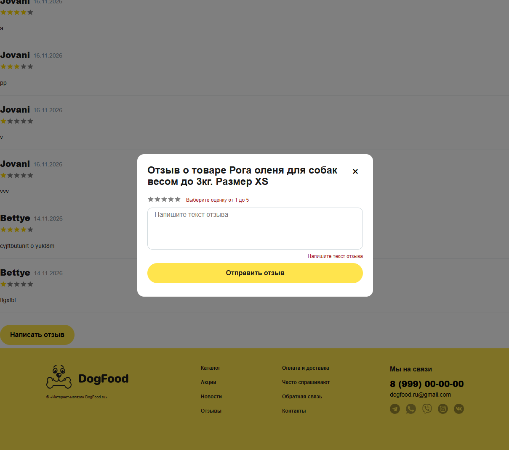

# React PRO — финальный проект

## Что сделано

### Архитектура и структура

1. Созданы и подключены общие компоненты `Button`, `Input`, `Textarea`, `NumberInput` и `Loader`. Удалены заменённые компоненты и дублирующие стили.
2. Выделены фичи авторизации, корзины, каталога, избранного и формы отзыва. Их компоненты, хуки и вспомогательные файлы размещены рядом.
3. Состояние пользователя и корзины с actions и selectors перенесено в `entities/user` и `entities/cart`. API товаров находится в `entities/product`.
4. Поиск, сортировка и подгрузка объединены в `features/catalog`.
5. Создание Redux Store и настройка маршрутов перенесены в `app`.
6. Компоненты получают состояние через селекторы и хуки там, где оно используется. Проверены границы слоёв и цепочки передачи props.
7. Добавлены публичные экспорты модулей, обновлены импорты, удалены пустые каталоги после переносов.

| Критерий                                                        | Балл | Что реализовано                                                                                                                                                                                                                                                                                                 |
| --------------------------------------------------------------- | ---- | --------------------------------------------------------------------------------------------------------------------------------------------------------------------------------------------------------------------------------------------------------------------------------------------------------------- |
| `shared/ui`: презентационные компоненты без стора и API         | 2    | Общие `Button`, `Input`, `Textarea`, `NumberInput`, `Loader`, `Rating` получают данные и обработчики через props. В `shared/ui` нет запросов к API и доступа к Redux. Проверки наличия товара в корзине, изменения количества, поиск и действия с избранным находятся вне общих UI-компонентов.                 |
| Изоляция фич; соблюдение слоёв `shared/`, `features/`, `pages/` | 1    | Выделены `auth`, `cart`, `catalog`, `favorites`, `reviews`. Общие модели размещены в `entities`, составные блоки — в `widgets`, настройка приложения — в `app`. Прямых обратных импортов между слоями и импортов между соседними фичами не обнаружено.                                                          |
| Устранение лишних prop-chains                                   | 1    | `Card` самостоятельно выбирает признак наличия товара в корзине и использует `useAddToCart`. `CartCounter` получает только `productId`, а данные и изменение количества берёт через `useCartCount`. `LikeButton` получает пользователя и токен через селекторы. Состояние каталога доступно его хукам напрямую. |

### Оптимизация рендеров

В React DevTools Profiler обнаружены лишние обновления корзины: при изменении количества одного товара обновлялись все три карточки и их счётчики, а также шапка. Исходный commit занял 1 мс.

Сохранены ссылки на неизменённые товары в reducer, сужена подписка `useCartCount`, добавлен `memo` для `CartItem`. Шапка подписана на число позиций. После оптимизации обновляется одна карточка и один счётчик вместо трёх, шапка не обновляется. Commit занял 0,8 мс. Добавлен `useMemo` для фильтрации избранного и подсчёта избранного в шапке.

Дополнительные записи лайков выявили обновления всех карточек в каталоге и избранном. Добавлены `memo(CardList)` и `memo(Card)`: список сравнивает массив товаров, карточка — свой товар. Повторные профили подтвердили: при изменении лайка в каталоге рендерится только выбранная карточка (1 рендер вместо 12 за цикл), а при снятии лайка в избранном оставшаяся карточка не обновляется (0 рендеров Card вместо 3). В обоих сценариях CardList обновляется один раз вместо двух.

| Критерий                          | Балл | Что реализовано                                                                                                                                                                                                          |
| --------------------------------- | ---- | ------------------------------------------------------------------------------------------------------------------------------------------------------------------------------------------------------------------------ |
| Profiler: найден и описан hotspot | 1    | При изменении количества одного товара обновляются одна строка и один счётчик вместо трёх; шапка больше не обновляется.                                                                                                  |
| Уместный React.memo               | 1,5  | `CartItem` пропускает обновления при прежнем `product`. Reducer сохраняет ссылки неизменённых товаров, подписка счётчика выбирает только свой товар. Также добавлены `memo(CardList)` и `memo(Card)` для списка товаров. |
| Точечные useMemo/useCallback      | 1,5  | Добавлен `useMemo` для фильтрации товаров и подсчёта избранного.                                                                                                                                                         |

### React.Portal — модальное окно

Добавлен `#modal-root` и общий `Modal` через `createPortal`. На странице товара кнопка «Написать отзыв» открывает форму отзыва в модалке.

| Критерий                                                          | Балл | Реализация                                                                                                      |
| ----------------------------------------------------------------- | ---- | --------------------------------------------------------------------------------------------------------------- |
| Портал работает, #modal-root добавлен, ESC/overlay обрабатываются | 2    | `createPortal` в `#modal-root`, нативный `dialog`, крестик, событие `cancel` и обработка клика вне границ окна. |
| Корректный фокус: установка при открытии, возврат на триггер      | 1    | Фокус на крестике после открытия, возврат на элемент-триггер при закрытии.                                      |

### useRef — реальное применение

В формах входа и регистрации добавлен автофокус на email при монтировании через `useRef` и `useEffect`.

| Критерий                                               | Балл | Реализация                                                                                                                                                                                   |
| ------------------------------------------------------ | ---- | -------------------------------------------------------------------------------------------------------------------------------------------------------------------------------------------- |
| Хранение состояния между рендерами без лишних рендеров | 1    | `isRequestPendingRef` в `LikeButton` блокирует повторные клики на время запроса. Флаг устанавливается синхронно перед запросом и сбрасывается в `finally`. Изменение ref не вызывает рендер. |
| Автофокус / DOM-интеракция                             | 1    | `emailInputRef.current?.focus()` в `SignInForm` и `SignUpForm` при монтировании.                                                                                                             |

### Альтернативная сборка — Vite + SWC

Добавлен `vite.config.mjs` с `@vitejs/plugin-react-swc` и `vite-plugin-svgr`.

Точка входа Vite — корневой `index.html` с `/src/index.tsx`.

Команды:

- `npm run build` — Webpack, результат в `dist/`.
- `npm run build:vite` — проверка TypeScript и Vite, результат в `dist-vite/`.
- `npm run start:vite` — сервер разработки Vite с SWC.
- `npm run preview:vite` — локальная проверка уже собранного `dist-vite/` по адресу из терминала.

Замеры ниже относятся к этапу альтернативной сборки, до обновления React до 19.

| Сборка  | Время, ms | JS, kB | Вся папка, kB |
| ------- | --------- | ------ | ------------- |
| Webpack | 19048     | 616    | 659           |
| Vite    | 7950      | 599.71 | 652.31        |

Вывод: в этом проекте полная сборка Vite примерно в **2,4 раза быстрее**, при этом размеры сборок почти не отличаются.

| Критерий                      | Балл | Реализация                                                                    |
| ----------------------------- | ---- | ----------------------------------------------------------------------------- |
| Рабочая альтернативная сборка | 1    | `npm run build:vite`, отдельный конфиг Vite + React SWC и каталог результата. |
| Сравнение с Webpack           | 1    | Время и размер сборок приведены в таблице выше, добавлен краткий вывод.       |

### React 19 hooks — отправка отзыва

Проект обновлён до React/React DOM 19 с соответствующими типами. MUI 5, React Redux 9 и Redux Toolkit 2 обновлены до совместимых версий.

В `ReviewForm` используется `useActionState`: хук хранит результат отправки и состояние `isPending`, а `formAction` передаётся в `<form action={formAction}>`. Данные считываются из `FormData` и отправляются через RTK Query на `POST /reviews/leave/:productId`. Проверяются непустой текст и оценка от 1 до 5.

Во время запроса кнопка показывает «Отправка…», повторная отправка и изменение полей недоступны. При успехе появляется сообщение, React автоматически сбрасывает неконтролируемый `Textarea`, а управляемая оценка сбрасывается в Action. При ошибке текст возвращается в состояние Action и используется как `defaultValue`, поэтому сброс формы сохраняет введённый текст; выбранная оценка также остаётся. После успешной отправки инвалидируются данные товара и списка, чтобы загрузить обновлённые отзывы.

| Критерий                       | Балл | Реализация                                                                                                        |
| ------------------------------ | ---- | ----------------------------------------------------------------------------------------------------------------- |
| Реальный UX-кейс с новым хуком | 2    | `useActionState` управляет отправкой `ReviewForm`, результатом Action и состоянием ожидания.                      |
| Ошибки и сброс формы           | 1    | Ошибки отображаются в форме без потери текста и оценки; после успеха поля очищаются, отзывы запрашиваются заново. |

### Демо формы в React Portal c useActionState



## Структура папок

```text
src/
├── app/                       # Настройка приложения и общие стили
│   ├── router/                # Маршруты
│   └── store/                 # Store, rootReducer, middleware и типы стора
├── entities/                  # Общие данные и модели
│   ├── cart/model/            # Состав корзины, actions и selectors
│   ├── user/model/            # Пользователь и сессия, actions и selectors
│   └── product/api/           # API товаров и RTK Query-кеш
├── features/                  # Пользовательские сценарии
│   ├── auth/                  # Вход, регистрация и защита страниц
│   │   ├── api/               # Запросы авторизации
│   │   ├── model/             # Типы и схемы валидации форм
│   │   └── ui/                # Формы и WithProtection
│   ├── cart/                  # Добавление, удаление и количество товаров
│   │   ├── model/             # Хуки управления корзиной
│   │   └── ui/                # Счётчики, список, элемент и итог корзины
│   ├── catalog/               # Поиск, сортировка и подгрузка
│   │   ├── model/             # catalogSlice и хуки каталога
│   │   └── ui/                # Search, Sort, LoadMore
│   ├── favorites/ui/          # LikeButton
│   └── reviews/               # ReviewForm, стили и API отправки отзыва
├── widgets/                   # Составные блоки интерфейса
│   ├── CardList/              # Список товаров, Card и Price
│   ├── ReviewList/            # Отзывы о товаре и форма отзыва
│   ├── Header/                # Шапка, поиск и ссылки на разделы
│   └── Footer/                # Подвал
├── pages/                     # Страницы и их компоновка
│                              # Home, Product, Favorites, Cart, Profile,
│                              # SignIn, SignUp, NotFound
└── shared/                    # Общий код и ресурсы
    ├── ui/                    # Button, Input, Textarea, NumberInput,
    │                          # Loader, Rating, ButtonBack, Logo, Modal
    ├── api/                   # Существующий API-сервис и вспомогательный хук
    ├── store/                 # Типизированные Redux-хуки, baseQuery, WithQuery
    ├── hooks/                 # Общие хуки
    ├── types/                 # Глобальные типы данных
    ├── utils/                 # Вспомогательные функции
    └── assets/                # Иконки и изображения
```
